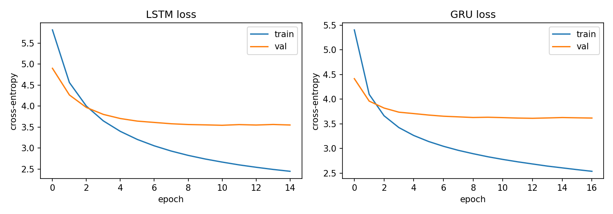

# Generating Music with Machine Learning

**UE24CS352A Machine Learning Mini-Project - Group 22 - Problem 22**

| Member | SRN |
|---|---|
| Nagashree R Patil | PES1UG24CS289 |
| Nallamalli Kanaka Mani Sai Akhil | PES1UG24CS290 |

## Overview
We learn a model of piano music from MIDI files and use it to generate new pieces. Each song is turned into a sequence of
*events* (the notes that start together plus the gap to the next onset). We compare three models on next-event prediction:

1. **Markov (bigram) baseline** - most frequent successor of the previous event
2. **LSTM** - 2 layers, 256 hidden units, dropout 0.3
3. **GRU** - same configuration with GRU cells

The work follows the Stanford project *Generating Music with Machine Learning* (Kang, Kim, Ringdahl, 2018).

## Repository structure
```
.
├── README.md
├── requirements.txt
├── .gitignore
├── docs/
│   ├── Generating Music with Machine Learning.pptx
│   ├── Work_Division_Group22.pdf
│   ├── Writeup_Draft_Group22.pdf
│   └── survey_results.csv
├── generated/
│   ├── 0_original.mid
│   ├── 1_markov.mid
│   ├── 2_lstm.mid
│   └── 3_gru.mid
├── notebooks/
│   └── music_generation.ipynb
└── results/
    ├── loss_curves.png
    └── results.csv
```

## Setup and run (Google Colab - recommended)
1. Open `notebooks/music_generation.ipynb` in Google Colab (File -> Upload notebook).
2. Runtime -> Change runtime type -> **T4 GPU**.
3. Runtime -> Run all. The first cells install `pretty_midi` and download the MAESTRO v3.0.0 MIDI dataset (about 60 MB).
4. When finished, the last cell downloads `generated.zip` (clips, `results.csv`, `loss_curves.png`).
   Copy these into `generated/` and `results/`.

## Setup and run (local)
```bash
python -m venv venv && source venv/bin/activate     # Windows: venv\Scripts\activate
pip install -r requirements.txt
jupyter notebook notebooks/music_generation.ipynb
```
Skip the `!apt-get` / `google.colab` cells at the end of the notebook when running locally. A GPU is optional but training is faster with one.

## Using your own MIDI files
Put `.mid` files in a folder named `midi_files/` next to the notebook; the notebook uses them instead of downloading MAESTRO.

## Dataset
[MAESTRO v3.0.0](https://magenta.tensorflow.org/datasets/maestro) piano MIDI, restricted to Chopin pieces (up to 120 files),
split 80/10/10 **by piece** into train/validation/test.

## Results
Fill in from `results/results.csv`.

### Training and validation loss curves


| Model | Test loss | Perplexity | Top-1 | Top-5 |
|---|---|---|---|---|
| Markov (bigram) | n/a | n/a | TBD | TBD |
| LSTM | TBD | TBD | TBD | TBD |
| GRU | TBD | TBD | TBD | TBD |

Generated clips are in `generated/` (`0_original.mid`, `1_markov.mid`, `2_lstm.mid`, `3_gru.mid`).

## Team contributions
| Member | Contribution |
|---|---|
| Nagashree R Patil | Data pipeline, Markov baseline, evaluation, write-up, README |
| Nallamalli Kanaka Mani Sai Akhil | LSTM/GRU models, training, generation, listening survey |

## Reference
D. Kang, J. Y. Kim, S. Ringdahl. *Project milestone: Generating music with machine learning.* Stanford, 2018.
